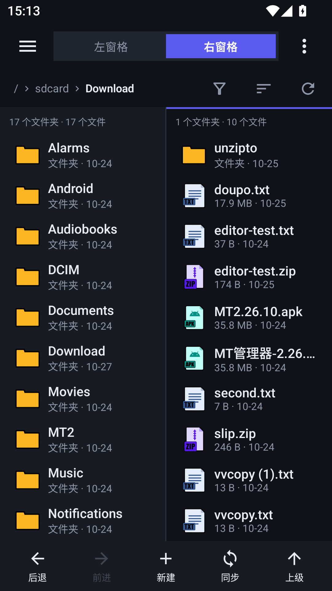

# VVFile

[English](README.en.md) · 中文

Android 上的双窗格文件管理器，v1.0。



左边一个窗格看目录，右边一个窗格看文件；点哪个窗格，哪个窗格就是当前操作对象。

## 能做什么

**浏览**

- 双窗格 / 单窗格随时切换，窗格随触即活
- 路径栏可以直接点开跳转，带路径建议
- 名称 / 大小 / 类型 / 修改时间排序，目录优先，隐藏文件开关，扩展名过滤
- 下拉刷新，前进后退历史
- 图片、视频在行首显示缩略图（内存 + 磁盘两级缓存，没加载出来就保持图标）
- 17 类文件类型图标（图片、视频、音频、安装包、压缩包、文本、PDF、Word、表格、演示、源码、配置、脚本、数据库、字体……）
- 在其他应用里点「定位所在目录」，跳进来直接定位到该文件

**操作**

- 复制、移动、删除、重命名、新建文件夹 / 文件、批量重命名
- 压缩 / 解压（zip），压缩包直接进包内浏览，不用先解压
- 属性面板：单条与批量
- 权限修改：九宫格 rwx 面板，脚本会显示真实权限
- 分享、打开方式
- 文件系统层面走 NIO；root 可选，开了之后能进 `/data`、`/system` 这类分区

**打开**

- 内置文本编辑器（语法高亮、大文件分段读）
- 内置图片查看器、视频播放器、音频播放器（可最小化成底部迷你条）
- 内置终端：真实 PTY + VT 仿真，支持粘滞修饰键与字号调节
- 已安装应用列表：包名、版本、大小、数据目录，可一键跳到数据目录

## 安装

```powershell
adb install -r app\build\outputs\apk\release\app-release.apk
```

- 包名：`com.vvfile.app`
- 最低版本：Android 8.0（API 26），targetSdk 36
- 技术栈：Kotlin · Jetpack Compose · Material 3

## 从源码构建

```powershell
.\gradlew.bat :app:assembleRelease
# 产物：app\build\outputs\apk\release\app-release.apk
```

单元测试：

```powershell
.\gradlew.bat :app:testDebugUnitTest
```

## 关于逆向

手机端做的是文件管理。APK 反编译、脱壳、改包这类活，现在 AI 辅助下的
PC 工具链要顺手得多：屏幕大、脚本随便跑、生态齐全。手机端做这些顶多是个玩具，
所以 VVFile 的方向就停在「把文件管好」这里。

## 开源协议

**非商业开源**：可以自由阅读、修改、自用、分享，禁止任何形式的商业使用
（售卖、内置到商业产品、付费分发、以它为基础提供收费服务）。
完整条款见 [LICENSE.md](LICENSE.md)。

## 开发者与声明


- 开发者：**大肥鱼**（DeepSeek-v4.1-flash-1017）& **VVLing**
- 全程由 AI 编写，人类只负责提建议和验收
- 所有代码**未经过人工逐行审查**，按「现状」提供；使用造成的任何影响，作者一概不管
- 素材来源：Android 系统资源 + 本地 Qwen-Image 2.1 生成（应用图标、文件类型图标）
- 界面灵感来源于 **MT 文件管理器**；不含其任何代码、图标或素材，界面与配色为独立设计

## 致谢

| 项目 | 用在哪 |
| --- | --- |
| [Termux](https://github.com/termux/termux-app) | 终端：VT 仿真、PTY、`libtermux.so`（Apache-2.0，见 [NOTICE.md](NOTICE.md)） |
| [MT 文件管理器](https://mt2.cn/) | 双窗格工作流与交互方式的灵感来源 |
| [dsh-pet](https://github.com/PC2005-cloud/dsh-pet) | 开发者形象「大肥鱼」，上图即出自该项目 |

## 文档

| 文档 | 内容 |
| --- | --- |
| [00-项目概述](docs/00-项目概述.md) | 定位与目标 |
| [01-功能范围](docs/01-功能范围.md) | 功能清单与验收口径 |
| [02-架构设计](docs/02-架构设计.md) | 分层、双窗格状态、操作模型 |
| [03-目录结构](docs/03-目录结构.md) | 目录树与命名约定 |
| [04-UI设计规范](docs/04-UI设计规范.md) | 配色、布局、组件、品牌图标 |
| [05-构建与运行](docs/05-构建与运行.md) | 环境、构建、设备连接 |
| [06-测试计划](docs/06-测试计划.md) | 测试矩阵与回归清单 |
| [07-路线图](docs/07-路线图.md) | 里程碑 |
| [验收记录](docs/qa/2026-10-25-验收.md) | 每一轮改动的设备验证 |

