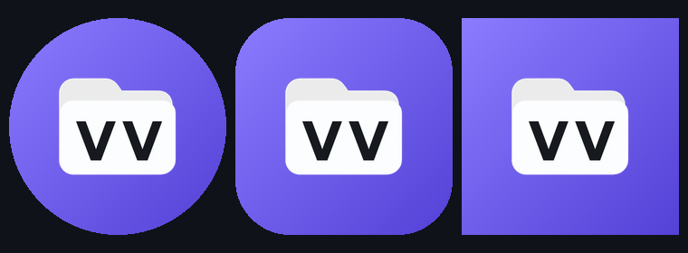

# 应用图标

启动器图标和文件类型图标出自同一条流水线（本地 ComfyUI + Qwen-Image 2.1），
主体是白色文件夹 + 近黑 `VV` 字标。



## 链路

| 步骤 | 文件 | 说明 |
| --- | --- | --- |
| 生成 | [gen.py](gen.py) | 调 ComfyUI `/prompt`，1024px、透明底，70 秒/张 |
| 选图 | [picks.json](picks.json) | 选定 `dir` + `art` 文件名 |
| 落盘 | [build.py](build.py) | 裁边 → 居中到 108dp 画布的 54% → 5 个密度 PNG |
| 输出 | `app/src/main/res/` | `mipmap-*/ic_launcher_foreground.png`、`ic_launcher_monochrome.png`、`drawable/ic_launcher_background.xml`、`drawable-nodpi/vvfile_app_icon.png` |

```powershell
C:\Tools\ComfyUI\.venv\Scripts\python.exe design\appicon\gen.py --seeds 2
# 改 picks.json 选定后
C:\Tools\ComfyUI\.venv\Scripts\python.exe design\appicon\build.py
```

## 为什么这么切

自适应图标是 **108dp 画布、中间 72dp 安全区**，系统最终按圆形/方圆裁切，
所以主体只占画布 **54%**：刚好落在安全区里，四周留出紫色边。
第一版做成了 66%，在 MuMu 桌面上白纸几乎顶到遮罩边，紫色只剩一圈发丝，
改成 54% 后比例才正常。

- **背景层**：`<shape>` 里的三色线性渐变（`angle=315`），不放位图，任何密度都清晰
- **前景层**：5 个密度各出一张 PNG（108/162/216/324/432px），缩放走预乘 alpha
- **主题图标**（Android 13 彩色主题图标）：把前景转成纯白剪影，
  亮度 ≥ 200 的像素保留、字标（近黑）挖空——这样系统染色后仍然看得出是个带 VV 的文件夹

## 试过但没用的方案

| 方案 | 问题 |
| --- | --- |
| 紫文件夹 + 白色 `VV` 字标 | 模型把两个 V 连在一起，生成出来像 `W` |
| 紫文件夹 + 双箭头 `»` | 读作「快进」，和文件管理没关系 |
| 紫文件夹 + 两个白窗格（双窗格） | 意思准确，但和「VV」品牌没关系，用户要求加字 |
| 白文件夹 + 白色 `VV` | 字和纸同色，看不见 |

最终用的是「白文件夹 + 近黑 VV」：字和纸对比最大，28dp 也不糊。
