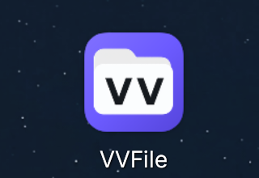
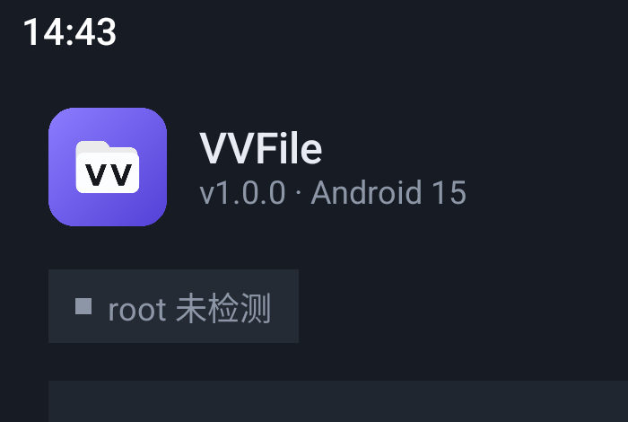

# UI 设计规范

## 1. 设计立场

功能骨架沿用"双窗格 + 底部操作条"这一通用文件管理器范式，但**视觉与信息组织独立设计**：

| 维度 | MT 管理器（参考） | VVFile（本项目） |
| --- | --- | --- |
| 主色 | 蓝 + 金色会员条 | 薄紫色 `#7C6CFF` + 薄荷绿点缀 `#34D399` |
| 顶栏 | 路径 + 两行统计，右侧三点 | 分段式窗格切换 + 单行面包屑，统计收纳为胶囊 |
| 图标 | 实心彩色分类图标 | 本地生成位图：淡彩纸面 + 象形图 + 类型角标（见 §11） |
| 行样式 | 紧凑双行 | 44dp 紧凑行，选中态整行高亮 |
| 工具入口 | 抽屉内长列表 | 抽屉内"存储卡片 + 分组工具"，桌面级留白 |
| 操作菜单 | 居中弹窗网格 | 底部 BottomSheet 分组列表 |
| 会员/广告 | 有 | 无 |

## 2. 色彩

```kotlin
// Dark（默认）
Background   = #0F1218
Surface      = #171C24
SurfaceHigh  = #1F2630
Divider      = #2A3340
TextPrimary  = #E8ECF2
TextSecondary= #8C96A6
Accent       = #7C6CFF   // 主强调：选中、活动窗格、FAB
AccentSoft   = #292447   // 强调色 12% 叠底
Mint         = #34D399   // 成功、root 已就绪、存储余量
Warn         = #F5A524
Danger       = #F0546A

// Light
Background   = #F7F8FA
Surface      = #FFFFFF
TextPrimary  = #14181F
Accent       = #5B4BE0
```

- 纯黑主题：Background `#000000`，Surface `#0A0A0A`，其余不变。
- 强调色预设：紫、青、绿、橙、玫红、蓝；只替换 Accent/AccentSoft。
- 对比度：正文 ≥ 4.5:1；次要文字 ≥ 3:1。

## 3. 字体与尺寸

| 元素 | 字号 / 字重 |
| --- | --- |
| 路径标题 | 20sp / SemiBold |
| 文件名 | 14sp / Medium |
| 元信息（大小·时间） | 11sp / Normal，次要色 |
| 分区标题 | 12sp / Medium，字距 +0.08em，大写感 |
| 终端/编辑器 | 13sp 等宽（JetBrains Mono / 系统 mono） |

- 行高 46dp，图标 20dp，行内边距 10dp，列表间距 1dp（贴近同类产品的单屏密度）。
- 圆角：行 10dp，卡片 16dp，Sheet 顶部 24dp，FAB 16dp。
- 触摸目标 ≥ 48dp。

## 4. 主界面（Browser）

```
┌──────────────────────────────────────────────┐
│ ≡   [ 左窗格 | 右窗格 ]            ⋮        │  TopAppBar 56dp
│  /sdcard/  ›  Download  ›  ...   [16 项]     │  Breadcrumb 40dp
├───────────────────────┬──────────────────────┤
│ 名称 ↑        大小    │ 名称          大小  │  两个 Pane
│ 📁 Android     —      │ 📁 Music       —     │
│ 📄 note.txt   1.2 KB  │ 📄 a.zip     4.1 MB  │
│ ...                   │ ...                  │
│                       │                      │
├───────────────────────┴──────────────────────┤
│  ‹   ›      ＋        ⇄        ↑            │  BottomBar 64dp
└──────────────────────────────────────────────┘
```

- 顶栏左侧汉堡打开抽屉；中间是分段控件，点击切换活动窗格（高亮下划线 + 强调色）；
  右侧溢出菜单（刷新/全选/过滤/排序/终端/隐藏文件/书签/设为首页/交换/设置/退出）。
- 面包屑只显示**活动窗格**路径；超长时从中间省略，首尾可点。
- 面包屑右侧显示当前条目数，选择态显示 `已选/总数`；文件夹/文件分项统计后续在 W2 补。
- 活动窗格顶部有 2dp 强调色描边；非活动窗格整体透明度 0.72。
- 每行：图标 + 名称（单行省略） + 第二行"大小 · 时间"；文件类型用扩展名着色小标签（可选）。
- 空目录：居中插画 + "此文件夹为空" + 新建按钮。
- 加载：骨架行 6 条；错误：内联卡片 + 重试/去授权。

## 5. 选择态

- 长按进入选择，顶栏切换为 `已选 3 项` + 关闭按钮 + 全选。
- 选中行仅做整行背景高亮，**不显示勾选控件**；在行上左滑或右滑同样可以选中/取消选中。
- 滑动时行内容随手轻移（0.55 阻尼、最大 28dp），松手回弹；位移超过 48dp 触发选中并伴随轻震动。
- 底部条切换为：复制、移动、删除、更多（重命名/压缩/分享/属性）。
- 选择态返回键先退出选择态。

## 6. 长按 / 更多菜单（BottomSheet）

分组：

1. 打开方式…（文件）/ 打开（目录）
2. 复制到… / 移动到…（"到…"表示用另一窗格为目标，并高亮对侧窗格 800ms）
3. 重命名 / 删除
4. 压缩 / 解压（zip）
5. 分享 / 属性
6. 添加书签 / 设为首页

危险项（删除）用 Danger 色，且与常规项间隔 8dp。

## 7. 抽屉

```
┌────────────────────────────┐
│  VVFile                    │  品牌区（无登录）
│  root 可用 · Android 15    │
│  ┌──────────────────────┐  │
│  │ 内部存储  38.2/125 GB│  │  存储卡片
│  │ ▓▓▓▓▓░░░░░░░░░  31%  │  │
│  └──────────────────────┘  │
│  工具                       │
│  📱 已安装应用              │
│  📝 文本编辑器              │
│  ▶ 终端模拟器               │
│  ⭐ 书签                    │
│  ⚙ 设置                     │
│  关于 VVFile 1.0          │
└────────────────────────────┘
```

- 抽屉宽 300dp，圆角右侧 24dp。
- 不出现会员、回收站、插件、MCP、Activity 记录入口。

## 8. 其他页面

| 页面 | 要点 |
| --- | --- |
| 终端 | 黑底、顶部会话切换（sh/root）、输出区等宽、底部输入行 + 发送；快捷命令条（ls/cd/pwd/id/whoami） |
| 编辑器 | 顶部文件名 + 保存/撤销/查找；左侧行号槽；底部状态栏（编码、行号、字符数） |
| 已安装应用 | 搜索框 + 列表（图标/名称/包名/大小），点击弹操作单 |
| 设置 | 分组卡片：外观、浏览、Root 与终端、关于；开关用 Material3 Switch |
| 属性 | 底部 Sheet：图标 + 名称、路径、大小、时间、权限、所有者、校验和（P1） |

## 9. 动效

- 进入目录：列表淡入 + 上移 8dp，180ms。
- 窗格切换：下划线指示器 200ms；活动窗格描边淡入。
- 长按菜单：BottomSheet 标准 spring。
- 复制进度：线性进度 + 百分比，可取消；完成后 Snackbar "已复制 12 项"。
- 遵循系统"移除动画"设置。

## 10. 无障碍与国际化

- 所有图标按钮有 `contentDescription`。
- 支持字体缩放至 200% 不截断关键操作（行高自适应）。
- 文案全部走 `strings.xml`；首版仅中文，预留英文资源目录。
- 颜色不作为唯一状态标识（选中同时有勾选图标）。

## 11. 品牌图标（启动器 + 抽屉）

应用图标和文件类型图标出自同一条本地生成流水线（Qwen-Image 2.1），
主体是**白纸夹 + 黑色 VV 字标**，压在紫色渐变底上：

| 部位 | 规格 |
| --- | --- |
| 底板 | 线性渐变 `#8B7CFF → #6C5BFF → #4A3ACB`，自适应图标的 background layer |
| 前景 | 白色文件夹 + 近黑 `VV`，占 108dp 画布的 54%（安全区内留足余量） |
| 主题图标 | `ic_launcher_monochrome`：白剪影 + 把 `VV` 挖空 |
| 应用内 | `drawable-nodpi/vvfile_app_icon.png`（512px，圆角 22%），抽屉抬头和关于页复用它 |





改动图标只需重跑 `design/appicon/gen.py` + `build.py`，
5 个密度的 `mipmap-*/ic_launcher_foreground.png`、`ic_launcher_monochrome.png`
和背景 XML 都会重新生成。
